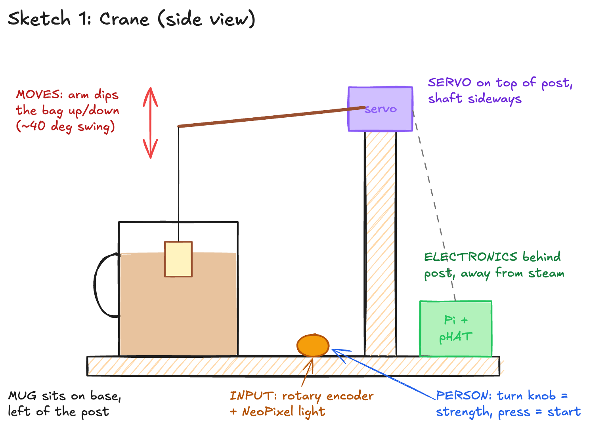
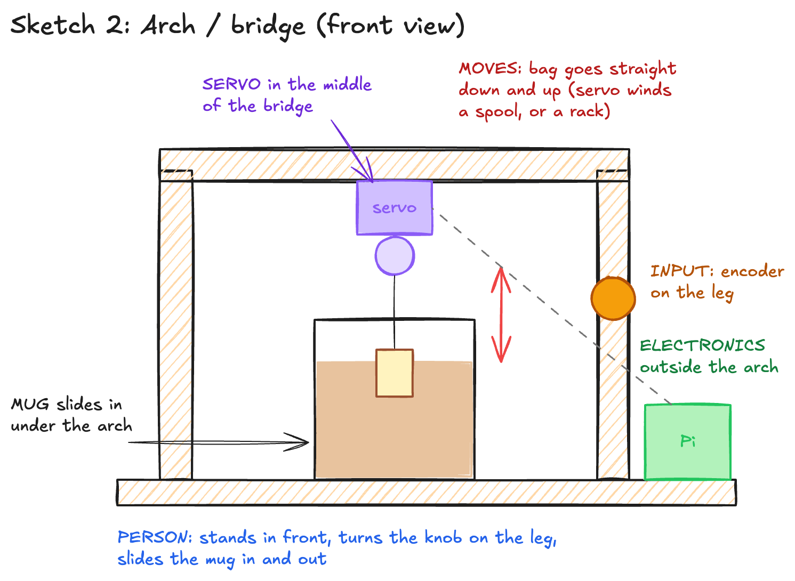
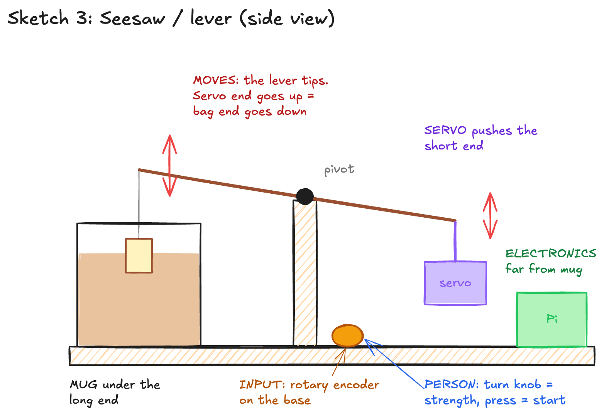
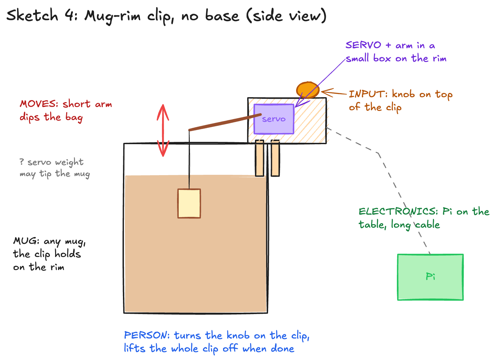
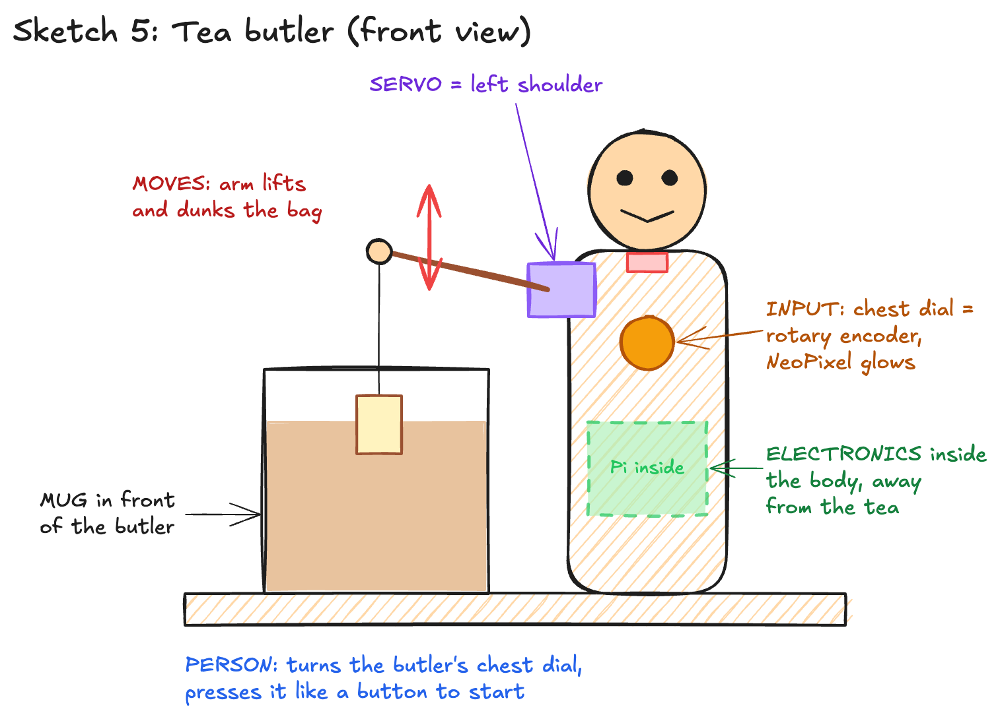

# Ph-UI!!!

Team: solo  
Members: Andreas Kilbinger (andikilbinger)  
Project name: Tea Bag Dunker

---

# Part 1

## Part A. Capacitive Sensing

I plugged the MPR121 capacitive sensor into the Qwiic port on the Mini PiTFT. The Pi found it at address `0x5a`. Then I ran `cap_test.py` and touched the pads. It picked up touches on pads 6, 7, 8, 9 and 10, so the sensor works.

<!-- TODO: photo of the cap sensor with something clipped to it -->

One thing I learned: when I plugged the sensor in while the Pi was running, the Pi rebooted. After that I always shut the Pi down before plugging in new boards.

## Part B. More Sensors

I tested every sensor one at a time with the example scripts.

**Light / proximity / gesture sensor (APDS-9960, `0x39`)**
- `proximity_test.py`: reads about 0 when nothing is close. It goes up to around 236 when my hand is right above it. It only reacts when you are really close (a few cm).
- `gesture_test.py`: my first try didn't detect anything. On the second try I swiped closer, about 2 to 5 cm above the sensor, and it picked up left and right swipes. I didn't get up and down to work in the time I tested.
- `color_test.py`: about 530 to 660 lux in the room. When I covered it, it went down to about 0. The lux number sometimes went a bit negative when it was covered, which seems to be a quirk of the library.

**Rotary encoder (`0x36`)**
- `encoder_test.py`: the position goes up and down when I turn the knob both ways, and pressing the knob shows "Button pressed" / "Button released".
- I also lit up the NeoPixel on the encoder and made it go red, green and blue.

**Joystick (`0x20`)**
- `joystick_test.py`: X and Y both go from 0 to about 1023 and sit at about 510 in the middle. The button reads 0 when pressed.

**Distance sensor (VCNL4040, `0x60`)**
- `qwiic_distance.py`: 0 when nothing is in front of it. It goes up to about 30 to 130 when my hand comes close. It only works well from about 1 to 10 cm. Right up against the sensor it went to 254 and then jumped back down to 2, so very close readings are not reliable.

<!-- TODO (optional): photo of the Pi with one of the sensors plugged in -->

## Part C. Servo Actuation

This part did not go smoothly.

The first time I connected the servo to my SparkFun Servo pHAT, it smelled burnt, so I unplugged it. The Pi and the Mini PiTFT were fine after that.

Then I tried to find what was broken:
- The Pi still found my pHAT on I2C at `0x40`.
- I read the chip's settings and it was sending a normal servo signal (50 Hz) on channel 0.
- The servo still didn't move on channel 0, 4 or 15.
- I held the servo in place with the code and tried to turn the arm by hand. It felt the same with the signal on and off, so the motor wasn't getting power.
- I tried the same servo on a friend's pHAT and it moved fine.

So the servo is ok and my pHAT is broken. My guess is the power part of the board (the USB-C side) burned out when it smelled. The chip still talks to the Pi, but no power gets to the servos.

<!-- TODO: get a replacement pHAT from the TA, run pi_servo_hat_test.py, and add a short video of the servo sweeping -->

---

## Part D. Physical Interaction Design: Feast Automata

### My idea: Tea Bag Dunker

If you forget the tea bag in the cup, the tea gets way too strong. So I want to build a little machine that dunks the tea bag for me and takes it out when it's done.

How it works:
1. You turn the rotary encoder to pick how strong you want the tea. The NeoPixel on the encoder shows the strength (light yellow = weak, dark brown/red = strong).
2. You press the knob to start. The servo lowers the tea bag into the mug.
3. While it steeps, the servo dunks the bag up and down every few seconds. The light slowly goes from green to orange to brown so you can see how much time is left.
4. When time is up, the arm lifts the bag out and holds it over the mug so it can drip. The light blinks.

Extra ideas if I have time:
- Weak tea gets slow, calm dunks and strong tea gets fast, crazy dunks.
- A copper tape pad on the base you can touch to stop it early (capacitive sensor).
- Use the color sensor to look at the tea through a glass cup and stop when it's dark enough, instead of a timer. I would need to keep it away from the steam.

### 5 sketches

I drew 5 different ways to put the sensor, servo and electronics together.

**Sketch 1: Crane.** A post next to the mug with the servo on top. A long arm reaches over the mug and the bag hangs from the end.

**Sketch 2: Arch / bridge.** A bridge over the mug with the servo in the middle. The bag goes straight up and down (the servo winds a string). You slide the mug in under it.

**Sketch 3: Seesaw / lever.** A lever on a pivot. The servo pushes the short end up, so the long end with the bag goes down.

**Sketch 4: Mug-rim clip.** A small box that clips onto the rim of any mug, with the servo and knob inside. No base needed.

**Sketch 5: Tea butler.** A cardboard butler standing next to the mug. The servo is his shoulder, so his arm dunks the bag. The encoder is a dial on his chest, and the Pi is hidden inside his body.

### What questions do the sketches raise?

- Can a small 9g servo lift a wet tea bag? A wet bag is heavier than a dry one.
- How far up does the bag need to go to come fully out of the tea? Does the arm move far enough for that?
- How do I keep the Pi and the boards away from the hot water and the steam?
- Will the cardboard stay stiff, or will it bend when the arm moves fast or gets wet?
- Will the whole thing tip over? This is a big question for the mug clip (sketch 4), where the servo sits on the rim.
- Can someone tell how strong the tea will be just from the color of the light?
- For the arch (sketch 2), winding a string on a spool is harder to build than just swinging an arm.

### What do I need to prototype to answer them?

- Build the arm and post and hang a real wet tea bag from it, to see if the servo can lift it and how high it goes.
- Try different arm lengths to get enough up and down movement.
- Put the electronics behind the post and pour hot water, to see how much steam reaches them.
- Push and shake the cardboard frame to see if it bends or tips.
- Let a friend use it without explaining the light, and see if they understand the colors.

### Which design I picked and why

I picked **Sketch 1, the crane**.
- It's the simplest to build. The servo just swings an arm, so I don't need a spool or a pivot.
- The electronics can sit behind the post, far from the hot tea.
- The base is big and flat, so it won't tip over like the mug clip might.
- It works with any mug that fits on the base.

The butler (sketch 5) is the most fun, so if the crane works I might put a butler "costume" on it later.

<!-- TODO: change this section if I end up picking a different sketch -->

### Rough prototype

<!-- TODO: build the cardboard crane and add photos/video here:
  - front view of the whole thing with the mug
  - side view showing the arm over the mug
  - close-up of the servo on the post
  - close-up of the encoder on the base
  - "in use" photo with the tea bag dunked
  - short video of the arm dunking (moved by hand if the new pHAT isn't here yet, and say so)
-->

---

# Part 2

Coming next: build the working dunker with the encoder and servo (`tea_dunker.py`), plus the looks-like, works-like and acts-like prototypes.
