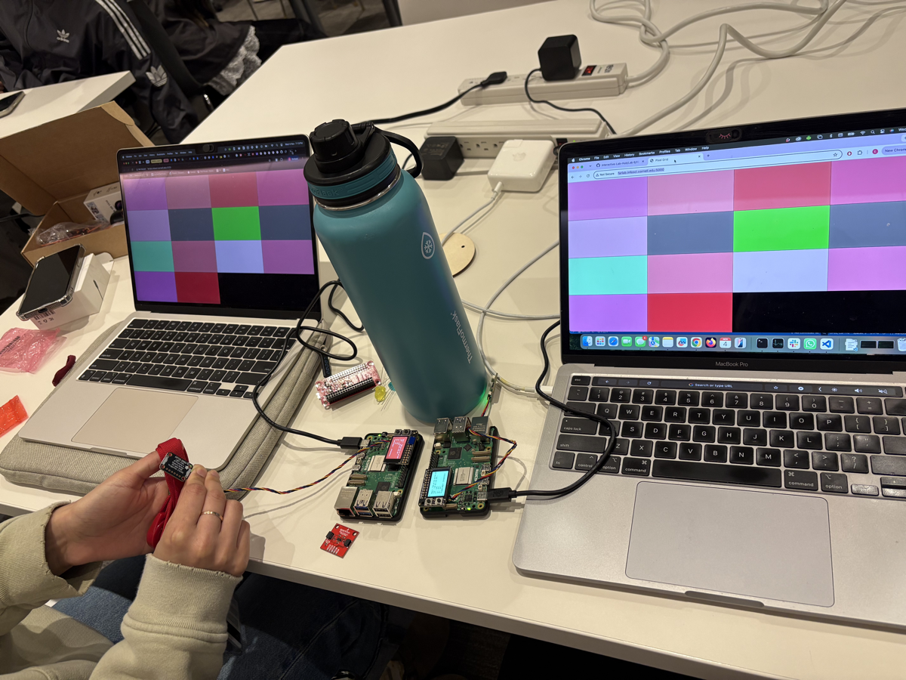

# Distributed Interaction

**Collaborators:**
- Edmond Kong (eck67, edmkong)
- Jacey Hu (ch2296, kakiko1111)
- Gabriela Yaulli (cgy4, cgyh98)

---

## Prep

1. Pull the new changes
2. Read: [The Presence Table](https://dl.acm.org/doi/10.1145/1935701.1935800) ([video](https://vimeo.com/15932020))

## Overview

Build interactive systems where **multiple devices communicate over a network** using MQTT messaging. Work in teams of 3+ with Raspberry Pis.

**Parts:**
- A: Learn MQTT messaging
- B: Try collaborative pixel grid demo  
- C: Build your own distributed system

---

## Part A: MQTT Messaging

MQTT = lightweight messaging for IoT. Publish/subscribe model with central broker.

**Concepts:**
- **Broker**: `farlab.infosci.cornell.edu:1883`
- **Topic**: Like `IDD/bedroom/temperature` (use `#` wildcard)
- **Publish/Subscribe**: Send and receive messages

**Install MQTT tools on your Pi:**
```bash
sudo apt-get update
sudo apt-get install -y mosquitto-clients
```

**Test it:**

**Subscribe to messages (listener):**
```bash
mosquitto_sub -h farlab.infosci.cornell.edu -p 1883 -t 'IDD/#' -u idd -P 'device@theFarm'
```

**Publish a message (sender):**
```bash
mosquitto_pub -h farlab.infosci.cornell.edu -p 1883 -t 'IDD/test/yourname' -m 'Hello!' -u idd -P 'device@theFarm'
```

> **💡 Tips:**
> - Replace `yourname` with your actual name in the topic
> - Use single quotes around the password: `'device@theFarm'`
> - For your own projects, publish under your team's topic space: `IDD/<yourteam>/...` (for example `IDD/team3/bedroom/light`). Everyone shares one broker login, so anything you publish can reach everyone's projects.

**🔧 Debug Tool:** View all MQTT messages in real-time at `http://farlab.infosci.cornell.edu:5001`


We will use IDD/mamaya for our team name. 
i.e. mosquitto_pub -h farlab.infosci.cornell.edu -p 1883 -t 'IDD/mamaya/edm' -m 'Hello!' -u idd -P 'device@theFarm'


**💡 Brainstorm 5 ideas for messaging between devices**

1. **Remote "thinking of you" button**: One Pi publishes `1` on `IDD/mamaya/<name>/nudge` when its button is pressed, and a friend's Pi lights up.
2. **Shared room-occupancy board**: Each Pi uses its proximity sensor to publish `occupied`/`empty` on `IDD/mamaya/<room>/presence`. A display Pi subscribes to `IDD/mamaya/+/presence` and shows which study rooms or desks are free.
3. **Plant care network**: A Pi next to a plant publishes light levels on `IDD/mamaya/plant/light`. When the light stays low for too long, another Pi elsewhere in the house shows "move me to the window!"
4. **Distributed rock-paper-scissors**: Two players have their Pi read a gesture and publish it on `IDD/mamaya/game/<player>`. A third Pi collects the moves and publishes the winner on `IDD/mamaya/game/result`.
5. **Ambient mood lamp**: Every Pi publishes the color it senses on `IDD/mamaya/<name>/color`. A lamp Pi averages all the colors and shows the blend, so the lamp reflects what everyone on the team is seeing.

---

## Part B: Collaborative Pixel Grid

Each Pi = one pixel, controlled by RGB sensor, displayed in real-time grid.

**Architecture:** `Pi (sensor) → MQTT → Server → Web Browser`

**Setup:**

1. **Sensor**

#### Light/Proximity/Gesture sensor (APDS-9960)
We use this sensor [Adafruit APDS-9960](https://www.adafruit.com/product/3595) for this exmaple to detect light (also RGB)
 


Connect it to your pi with Qwiic connector


We need to use the screen to display the color detection, so we need to stop the running piscreen.service to make your screen available again

```bash
# stop the screen service
sudo systemctl stop piscreen.service
```

if you want to restart the screen service
```bash
# start the screen service
sudo systemctl start piscreen.service
```
 
2. **Server** (one person on laptop):
```bash
cd "Lab 6"
python -m venv .venv
source .venv/bin/activate
pip install -r requirements-server.txt
python app.py
```

2. **View in browser:**
   - Grid: `http://farlab.infosci.cornell.edu:5000`
   - Controller: `http://farlab.infosci.cornell.edu:5000/controller`

3. **Pi publisher** (everyone on their Pi):
```bash
# First time setup - create virtual environment
cd "Lab 6"
python -m venv .venv
source .venv/bin/activate
pip install -r requirements-pi.txt

# Run the publisher
python pixel_grid_publisher.py
```

Hold colored objects near sensor to change your pixel!


**📸 Include: Screenshot of grid + photo of your Pi setup**



Two Pis with APDS-9960 sensors publish their colors to the shared grid. The same grid is open on both laptops. We cannot remove the other tiles in the grid, but we pointed our sensors to unique colors. One is pointed to a brown box, and another is pointed to a blue bottle.

---

## Part C: Make Your Own

**Requirements:**
- 3+ people, 3+ Pis
- Each Pi contributes sensor input via MQTT
- Meaningful or fun interaction

**Ideas:**

**Sensor Fortune Teller**
- Each Pi sends 0-255 from different sensor
- Server generates fortunes from combined values

**Frankenstories**
- Sensor events → story elements (not text!)
- Red = danger, gesture up = climbed, distance <10cm = suddenly

**Distributed Instrument**
- Each Pi = one musical parameter
- Only works together

**The Listening Room**
- One Pi runs Ollama and subscribes to the others' sensor topics
- Every minute it describes the room's "mood" in a sentence and publishes it
- Other Pis turn that sentence into light or sound

**Others:** Games, presence display, mood ring

### Our Project: Gossiping Pis

Three Pis gossip with each other over MQTT. Swiping over a sensor starts a rumor, and the rumor spreads from Pi to Pi. If someone leans in to eavesdrop, the whole group goes quiet and makes small talk until the person backs off. Code: [`gossip.py`](gossip.py).

| Pi | Role | Sensor input | Run with |
|---|---|---|---|
| Edmond | Gossiper | APDS-9960 gesture: swipe to start a rumor | `--apds` |
| Jacey | Gossiper | APDS-9960 gesture: swipe to start a rumor | `--apds` |
| Gabi | Lookout | VCNL4040 proximity: someone leaning in hushes the group | `--vcnl --speak` |

**MQTT topics** (all under `IDD/mamaya/gossip/`, published automatically by `gossip.py`):

| Topic | Payload | When it's sent |
|---|---|---|
| `hello/<pi>` | `{"known": [rumor ids], "hush": bool}` | Every 2 seconds, listing the rumors this Pi knows |
| `rumor/<to-pi>` | `{"from", "rid", "text", "origin"}` | When a hello shows another Pi is missing a rumor |
| `hush/<pi>` | `1` / `0` | When the VCNL4040 sees someone lean in, and again when they leave |
| `bye/<pi>` | empty | Sent by the broker (MQTT "last will") if a Pi drops off |

**Setup on each Pi** (inside the Lab 6 venv from Part B):
```bash
cd "Lab 6"
source .venv/bin/activate
pip install -r requirements-pi.txt
sudo apt install -y espeak-ng                  # any Pi with a speaker
pip install adafruit-circuitpython-vcnl4040    # Gabi's Pi only
```

**Running it:**
```bash
# Edmond and Jacey (gossipers): swipe over the APDS-9960 to start a rumor
python gossip.py --apds

# Gabi (lookout): find the threshold first, then run
python gossip.py --calibrate
python gossip.py --vcnl --speak --listen-threshold <number> --voice en+f3
```

- Add `--speak` on any Pi that has a speaker.
- On any Pi, you can also type a line and press Enter to start a rumor.
- Each Pi uses its hostname as its name. To set it yourself, use `--name pi-jacey`.
- No hotspot is needed. Campus Wi‑Fi works because every Pi only connects to the broker.
- Optional: `--ble` makes Pis gossip only when they're physically close, based on Bluetooth signal strength.
- To watch the messages live, open `http://farlab.infosci.cornell.edu:5001` and filter by `IDD/mamaya/gossip`.

### Deliverables

Replace this README with your documentation:

**1. Project Description**
- What does it do? Why interesting? User experience?

**2. Architecture Diagram**
- Hardware, connections, data flow
- Label input/computation/output

**3. Build Documentation**
- Photos of each Pi + sensors
- MQTT topics used
- Code snippets with explanations

**4. User Testing**
- **Test with 2+ people NOT on your team**
- Photos/video of use
- What did they think before trying?
- What surprised them?
- What would they change?

**5. Reflection**
- What worked well?
- Challenges with distributed interaction?
- How did sensor events work?
- What would you improve?
- Where did computation happen in your system, and why there? (If you used a language model: did it run on every event, or only at setup?)


**Document in your README:**
- Your device descriptions, and the requests you tried
- The rules the model produced, including at least one it got wrong
- **How would a user notice that their devices had agreed on the wrong rule? How would they fix it?**

---

## Code Files

**Server files:**
- `app.py` - Pixel grid server (Flask + WebSocket + MQTT)
- `mqtt_viewer.py` - MQTT message viewer for debugging
- `mqtt_bridge.py` - MQTT → WebSocket bridge
- `requirements-server.txt` - Server dependencies

**Pi files:**
- `pixel_grid_publisher.py` - Example (RGB sensor → MQTT)
- `requirements-pi.txt` - Pi dependencies

**Web interface:**
- `templates/grid.html` - Pixel grid display
- `templates/controller.html` - Color picker
- `templates/mqtt_viewer.html` - Message viewer

---

## Debugging Tools

**MQTT Message Viewer:** `http://farlab.infosci.cornell.edu:5001`
- See all MQTT messages in real-time
- View topics and payloads
- Helpful for debugging your own projects

**Command line:**
```bash
# See all IDD messages
mosquitto_sub -h farlab.infosci.cornell.edu -p 1883 -t "IDD/#" -u idd -P "device@theFarm"
```

---

## Troubleshooting

**MQTT:** Broker `farlab.infosci.cornell.edu:1883`, user `idd`, pass `device@theFarm`

**Sensor:** Check `i2cdetect -y 1`, APDS-9960 at `0x39`

**Grid:** Verify server running, check MQTT in console, test with web controller

**Pi venv:** Make sure to activate: `source .venv/bin/activate`


---

## Submission Checklist

Before submitting:
- [ ] Delete prep/instructions above
- [ ] Add YOUR project documentation
- [ ] Include photos/videos/diagrams  
- [ ] Document user testing with non-team members
- [ ] Add reflection on learnings
- [ ] List team names at top

**Your README = story of what YOU built!**

---

Resources: [MQTT Guide](https://www.hivemq.com/mqtt-essentials/) | [Paho Python](https://www.eclipse.org/paho/index.php?page=clients/python/docs/index.php) | [Flask-SocketIO](https://flask-socketio.readthedocs.io/)
